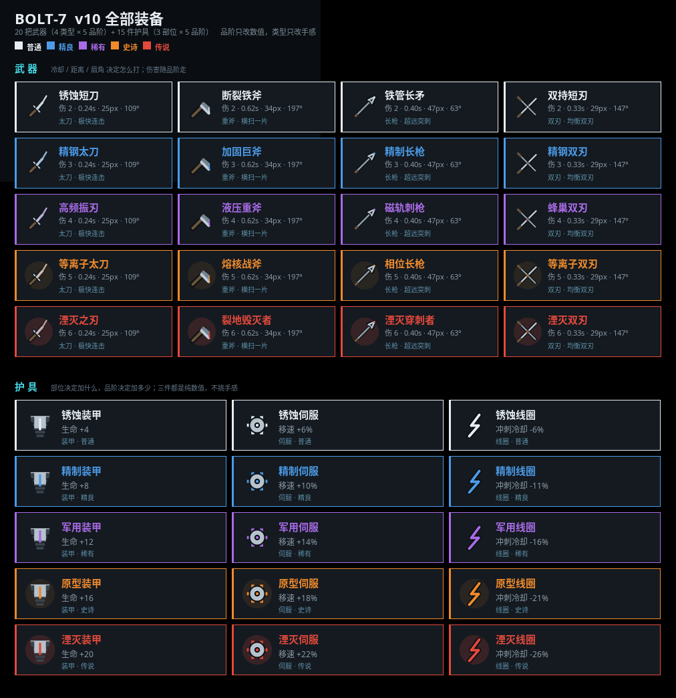
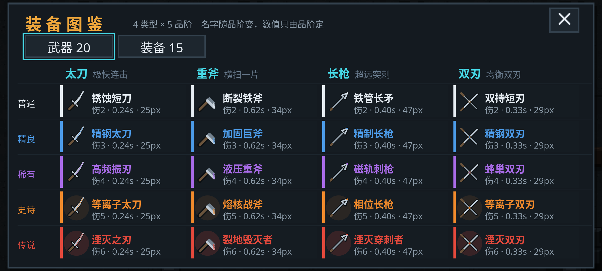
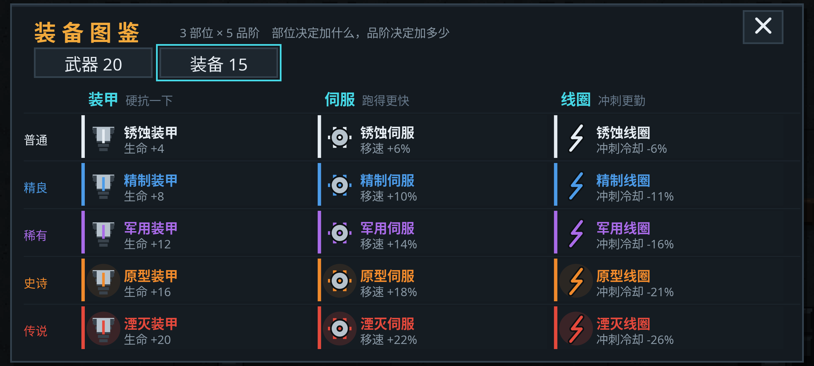
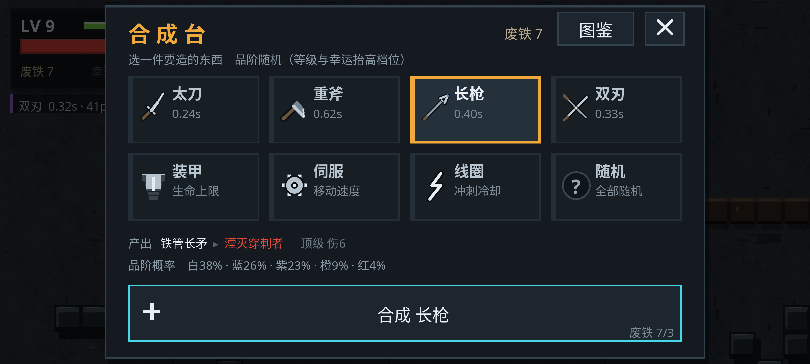

# BOLT-7 · 荒野回收

一个**纯离线**的安卓俯视角像素动作游戏：操控荒野维修机器人 BOLT-7 在 5120×3840 像素的废墟里自由探索，捡电池升级、敲废料做装备、打怪爆品阶装，顺手把三座 Boss 巢穴拆了。

- **v10.0** · 安装包 89 KB · Android 5.0+（minSdk 21）
- 原生 Android：Java + Canvas + SurfaceView，**零第三方库、零 Gradle、无网络权限**
- 同签名覆盖安装保留存档；一局 15 分钟能打穿一个区域，长线靠装备品阶和词条



---

## 特性

| | |
| --- | --- |
| **四种武器，四种手感** | 太刀 0.24s / 重斧 0.62s / 长枪 0.40s / 双刃 0.33s，判定锥、攻击距离、顿帧、硬直各不相同 |
| **五档品阶 × 四类武器** | 普通→传说，同一把太刀从「锈蚀短刀」长到「湮灭之刃」 |
| **35 件装备图鉴** | 游戏内一页看完 20 把武器 + 15 件护具的实际数值 |
| **合成台 8 类产物** | 想造哪一类就造哪一类，武器类型由玩家指定，不再随机抽 |
| **15 张词条卡** | 升级三选一：锋利、疾风、横扫、铁壁、压制、汲取……，外加幸运专属的**反弹 / 闪躲 / 庇护** |
| **武器能切子弹** | 挥击范围内的敌方弹丸直接消掉；带「反弹」词条则原路打回去 |
| **招架** | 命中即起 0.85 秒格挡，受伤 ×0.1（保底 1 点），攻守靠贴脸连击切换 |
| **三区域 + 3 座 Boss** | 靠近巢穴血条才浮出，不挡视野 |

<p>



</p>

---

## 安装

直接下载 [dist/BOLT-7-v10.0.apk](dist/BOLT-7-v10.0.apk)（89 KB），传到手机点开安装；系统提示「未知来源应用」时允许一次（自签名包，无广告无内购）。

```bash
adb install -r dist/BOLT-7-v10.0.apk
```

## 操作

| 操作 | 方式 |
| --- | --- |
| 移动 | 左半屏任意位置按下拖动（浮动摇杆，八向） |
| 攻击 | 右下红色圆键，按住连续挥击，**命中即进入招架** |
| 冲刺 | 红色键左侧青色小键，0.14 秒位移 + 无敌帧 |
| 背包 / 合成台 / 图鉴 | 右上角箱子图标（打开即暂停）；站在合成台上会多一个「合成」入口 |
| 暂停 | 右上角两条竖线，或手机返回键 |

---

## 全部 35 件装备

**武器**：品阶只改伤害（2→6），类型只改手感。

| 类型 | 普通 | 精良 | 稀有 | 史诗 | 传说 |
| --- | --- | --- | --- | --- | --- |
| 太刀 0.24s | 锈蚀短刀 | 精钢太刀 | 高频振刃 | 等离子太刀 | 湮灭之刃 |
| 重斧 0.62s | 断裂铁斧 | 加固巨斧 | 液压重斧 | 熔核战斧 | 裂地毁灭者 |
| 长枪 0.40s | 铁管长矛 | 精制长枪 | 磁轨刺枪 | 相位长枪 | 湮灭穿刺者 |
| 双刃 0.33s | 双持短刃 | 精钢双刃 | 蜂巢双刃 | 等离子双刃 | 湮灭双刃 |

**护具**

| 部位 | 普通 | 精良 | 稀有 | 史诗 | 传说 |
| --- | --- | --- | --- | --- | --- |
| 装甲（生命上限） | 锈蚀装甲 +4 | 精制装甲 +8 | 军用装甲 +12 | 原型装甲 +16 | 湮灭装甲 +20 |
| 伺服（移动速度） | 锈蚀伺服 +6% | 精制伺服 +10% | 军用伺服 +14% | 原型伺服 +18% | 湮灭伺服 +22% |
| 线圈（冲刺冷却） | 锈蚀线圈 −6% | 精制线圈 −11% | 军用线圈 −16% | 原型线圈 −21% | 湮灭线圈 −26% |

---

## 构建

不需要 Gradle。只要 Android SDK（build-tools 34.0.0 + platform android-34）和 JDK 8+：

```bash
./build.sh                 # 产出 ./BOLT-7-debug.apk
./build.sh out/BOLT-7.apk  # 或指定输出路径
```

脚本按 `aapt2 → javac → d8 → zipalign → apksigner` 五步走；首次构建会自动生成 `keystore.jks`（口令见脚本），想给旧包做覆盖升级请自行备份这个文件。

改版本号在 `build.sh` 里的 `--version-code` / `--version-name`。

## 测试与预览

`tools/` 是桌面端无头模拟器，游戏逻辑用 `GC` 接口从 Canvas 解耦，所以同一份代码能在 JVM 上跑：

```bash
# 321 项断言：碰撞、战斗、招架、词条、幸运、背包、9 种怪物、合成台、UI 命中、5 种分辨率
javac -cp build/classes -d /tmp/tools tools/*.java
java -cp build/classes:/tmp/tools SimTest

java -cp build/classes:/tmp/tools Soak       # 36000 帧压力测试
java -cp build/classes:/tmp/tools Preview preview   # 渲染全部截图到 preview/
```

## 目录结构

```
app/src/main/java/com/bolt7/factory/
  Game        状态机、战斗结算、升级、合成、指针事件分发
  Ui          按钮布局 + 命中测试（布局与绘制共用同一份坐标）
  Renderer    全部绘制：地形、角色、武器、特效、HUD、各类面板
  World       地图生成、区块、Boss 巢穴
  Player / Enemy / Plasma / Bag / Item / Weapon / Perk
  GC          绘图接口（AndroidGC / PreviewGC 两种实现）
tools/        SimTest / Soak / Preview（桌面无头运行）
docs/         截图
dist/         已签名安装包
```

## 版本记录

从横版跑酷到开放世界、从固定手感到武器类型、从单件升级到合成台与图鉴，逐版改动和踩过的坑都在 [CHANGELOG.md](CHANGELOG.md)。
